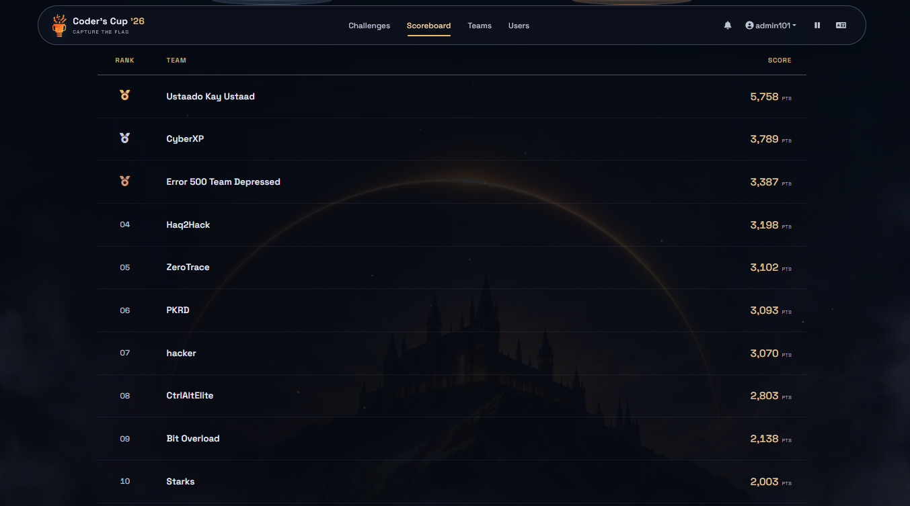

# Coder’s Cup ’26 — Challenge Write-ups

This post-event educational release contains write-ups and challenge material for the challenges solved during Coder’s Cup ’26. It excludes unsolved challenges and event-only data such as production configuration, runtime containers, database data, organizer tooling, and secrets.

## Final leaderboard

## How to use these write-ups

1. Open the relevant category folder, then choose a challenge directory.
2. Read `CHALLENGE.md` for the original challenge brief.
3. If present, follow `RUN_LOCALLY.md` and use `challenge-files/` or `source/` to make the challenge live on your own machine.
4. Try to solve it yourself first, then use `WRITEUP.md` to compare your approach with the intended solution and flag format.

File-based and OSINT challenges do not require a local service. For dynamic-container challenges, `<hash>` represents the per-team value used during the event.

## Challenge authors

| Author | Main categories and contributions |
| --- | --- |
| Muz4mmil / Syed Muzammil | Forensics; selected Cryptography, Reverse Engineering, Miscellaneous, and OSINT challenges |
| Ah54n | Cryptography; selected Miscellaneous and OSINT challenges |
| H454N | PWN and Reverse Engineering challenges |
| k4zim | Web Exploitation challenges |

Individual challenge attribution appears in the tables below and in every `CHALLENGE.md`.

## Included challenges

### Cryptography

| Challenge | Initial points | Author | Source |
| --- | ---: | --- | --- |
| [Baby RSA](cryptography/baby-rsa/) | 200 | Muz4mmil | Included |
| [Lost in Translation](cryptography/lost-in-translation/) | 350 | Ah54n | Included |
| [The Last Newline](cryptography/the-last-newline/) | 500 | Ah54n | Included |
| [The Ravenclaw Cipher](cryptography/the-ravenclaw-cipher/) | 200 | Ah54n | Included |

### Forensics

| Challenge | Initial points | Author | Source |
| --- | ---: | --- | --- |
| [The Castle's Hidden Chamber](forensics/the-castles-hidden-chamber/) | 200 | Muz4mmil | Included |
| [The Secrets of Hogwarts Castle](forensics/the-secrets-of-hogwarts-castle/) | 350 | Muz4mmil | Included |
| [The Seventh Spire](forensics/the-seventh-spire/) | 500 | Muz4mmil | Included |
| [Three Clocks](forensics/three-clocks/) | 350 | Muz4mmil | Included |

### Miscellaneous

| Challenge | Initial points | Author | Source |
| --- | ---: | --- | --- |
| [The Forgotten Handshake](miscellaneous/the-forgotten-handshake/) | 200 | Muz4mmil | Archival files only |
| [The Goblin’s Debt](miscellaneous/the-goblins-debt/) | 500 | Ah54n | Included |

### OSINT

| Challenge | Initial points | Author | Source |
| --- | ---: | --- | --- |
| [Between Two Eras](osint/between-two-eras/) | 350 | Muz4mmil | Archival files only |
| [Binod](osint/binod/) | 200 | Ah54n | Archival files only |
| [Dead Drop](osint/dead-drop/) | 500 | Ah54n | Archival files only |
| [Echoes of Olympus](osint/echoes-of-olympus/) | 350 | Muz4mmil | Archival files only |
| [Operation Spoiled Brackets](osint/operation-spoiled-brackets/) | 500 | Ah54n | Archival files only |
| [The Professional Footprint](osint/the-professional-footprint/) | 200 | Syed Muzammil | Archival files only |

### PWN

| Challenge | Initial points | Author | Source |
| --- | ---: | --- | --- |
| [The Forbidden Shelf](pwn/the-forbidden-shelf/) | 350 | H454N | Included |
| [The Sorting Hat's Permission Slip](pwn/sorting-hats-permission-slip/) | 200 | H454N | Included |

### Reverse Engineering

| Challenge | Initial points | Author | Source |
| --- | ---: | --- | --- |
| [Ravenclaw's Rotating Runes](reverse-engineering/ravenclaws-rotating-runes/) | 350 | H454N | Included |
| [Snape's Potion Ledger](reverse-engineering/snapes-potion-ledger/) | 200 | H454N | Included |
| [The Enchanted Parchment](reverse-engineering/the-enchanted-parchment/) | 350 | H454N | Included |
| [The Forbidden Payload](reverse-engineering/the-forbidden-payload/) | 350 | Muz4mmil | Included |

### Web Exploitation

| Challenge | Initial points | Author | Source |
| --- | ---: | --- | --- |
| [Catalog Filter](web-exploitation/catalog-filter/) | 350 | k4zim | Included |
| [Report Vault](web-exploitation/report-vault/) | 350 | k4zim | Included |
| [Student Greeter](web-exploitation/student-greeter/) | 350 | k4zim | Included |

## Note on unpublished challenges

Write-ups for challenges that received no successful solves during the event have not been published.
